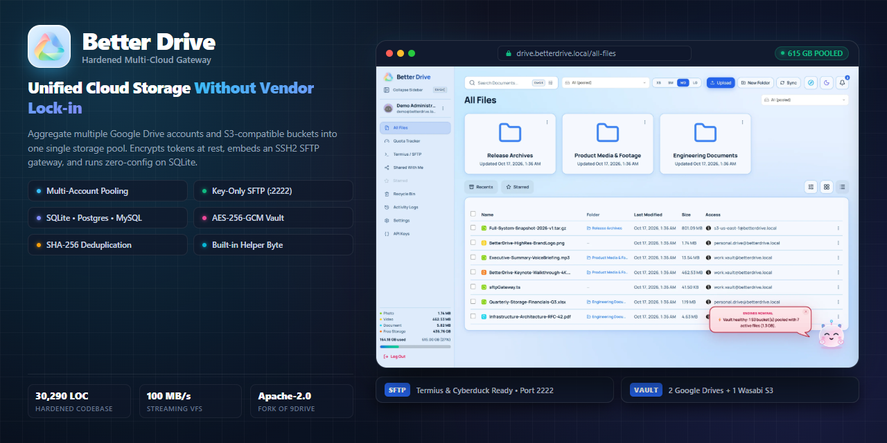

<div align="center">

  

  <br /><br />

  <h1>BetterDrive</h1>

  <p>
    <strong>A hardened, self-hosted multi-cloud storage gateway and virtual filesystem.</strong><br />
    Pools multiple Google Drive accounts and S3-compatible buckets into one high-performance vault.<br />
    Zero-config local SQLite (WAL mode), embedded key-only SFTP gateway, and authenticated AES-256-GCM encryption at rest.
  </p>

  <p>
    <a href="https://github.com/StromOG/Better-Drive/actions"></a>
    <a href="LICENSE"></a>
    <a href="package.json"></a>
    <a href="docs/architecture.md"></a>
    <a href="docs/security.md"></a>
  </p>

  <p>
    <a href="#quickstart">Quickstart</a> •
    <a href="#screenshots">Screenshots</a> •
    <a href="#key-features">Key Features</a> •
    <a href="#upstream-comparison">Upstream Comparison</a> •
    <a href="#documentation">Documentation</a> •
    <a href="#production-deployment">Production</a>
  </p>

</div>

---

## What is BetterDrive?

**BetterDrive** is an open-source, hardened multi-cloud storage gateway and virtual filesystem (VFS). It bridges independent personal or enterprise cloud storage services—including multiple Google Drive accounts (15 GB free slices), AWS S3, Cloudflare R2, MinIO, Wasabi, and Backblaze B2—into an aggregated, unified storage pool under a single logical folder tree.

Forked from [9Drive](https://github.com/zenhosta/9drive), BetterDrive is re-engineered from the ground up to solve upstream architectural and security design flaws:
- **Security Hardening**: Authenticated `AES-256-GCM` token encryption at rest, secure `HttpOnly; SameSite=Lax; Secure` cookie sessions, constant-time cryptographic hash verification, and removal of unauthenticated shell execution surfaces.
- **Embedded SFTP Gateway**: Native SSH2-based SFTP daemon running on port 2222 that accepts authorized Ed25519 and RSA public keys, jailing transfers into a virtual filesystem with zero local disk buffering.
- **Multi-Account Switching & Allocation Engine**: Dynamic quota-weighted router that directs uploads to the account with the largest available space, coupled with a persistent header Account Switcher (`All (pooled)` vs. single-account views).
- **Responsive Folder Scaling & Visuals**: Real-time folder size scaling (`XS | SM | MD | LG`), 36 offline vector icons, custom folder color accents, and instant responsive layouts without external CDN dependencies.
- **Byte Companion**: Intelligent floating storage co-pilot providing live engine diagnostics (double-click), interactive guided walkthroughs directly inside his speech bubble (3-click), and a one-time onboarding welcome on account creation.
- **Zero-Config SQLite**: Built-in SQLite in WAL mode for effortless, single-command startup with automated schema parity synchronization across PostgreSQL and MySQL.

---

## Screenshots

### 1. Unified Virtual File Explorer
Browse aggregated multi-cloud storage under a single namespace. Toggle between clean Arctic Pure light theme and high-contrast Midnight Nebula dark theme.

<div align="center">
  
  <p><em>All Files explorer showing folder grids, persistent Account Switcher, responsive folder scaling controls, and smart companion Byte. (<a href="docs/assets/screenshots/all-files-dark.webp">View Dark Mode</a>)</em></p>
</div>

---

### 2. Multi-Account Switcher (Pooled vs. Account-Scoped)
Instantly switch between the aggregated multi-cloud pool and isolated single-account storage. Notice the active dropdown on the left and the scoped file filter on the right.

| Account Switcher Dropdown (Open) | Scoped to Single Cloud Account |
|:---:|:---:|
|  |  |

---

### 3. Deep Metadata Search & Filter Drawer
Filter aggregated files by MIME category, size brackets, or date ranges.

<div align="center">
  
  <p><em>Collapsible filter drawer filtering by MIME category (Photos, Video, Audio, Documents, Archives, Code), size brackets, and date ranges.</em></p>
</div>

---

### 4. Team Collaboration & Connected Cloud Storage
Invite team members with three-tier RBAC (`owner`, `admin`, `member`) and manage connected Google Drive accounts and S3 buckets with real-time health checks.

| Team & Member Access | Connected Storage Accounts & Hub |
|:---:|:---:|
|  |  |

---

### 5. Embedded SFTP Gateway (Port 2222)
Stream files directly from native SFTP clients (Termius, FileZilla, Cyberduck) using SSH keys, jailed to the virtual filesystem.

<div align="center">
  
  <p><em>Embedded SSH2 SFTP daemon configuration showing authorized Ed25519 keys, SHA-256 fingerprint, and Termius setup walkthrough.</em></p>
</div>

---

### 6. Inline Media Viewers & Code Previews
Preview audio files, images, PDFs, and syntax-highlighted source code directly in the browser with zero external CDN dependencies.

| Audio Player Preview | Source Code Editor Preview |
|:---:|:---:|
|  |  |

*Browse all 25 interface views in the [Screenshots Gallery](docs/screenshots.md).*

---

## Key Features

### Unified Storage & Dynamic Allocation
- **Multi-Provider Pooling**: Aggregates arbitrary Google Drive accounts and S3-compatible buckets (AWS S3, Wasabi, Cloudflare R2, MinIO, Backblaze B2) into one unified file tree.
- **Dynamic Quota Allocation**: Uploads automatically route to the connected account with the largest available free space.
- **Zero-Disk Buffering**: Streams uploads directly to cloud providers via 64 KB memory chunks without holding entire files on the host drive.
- **Inline Deduplication**: Computes SHA-256 hashes during transfer; rejects identical duplicate files in the target directory (`409 DUPLICATE_CONTENT`).
- **Persistent Account Switcher**: Always accessible dropdown allowing instantaneous switching between `All (pooled)` multi-cloud view and isolated single-account views (`Google Drive`, `AWS S3`, `Cloudflare R2`, `MinIO`, `Wasabi`, `Backblaze B2`).
- **Instant Folder Scaling (`XS | SM | MD | LG`)**: Seamlessly scale folder cards on the fly with instant responsive layout recalculation.
- **Offline Vector Visuals**: 36 curated, offline Lucide React vector folder icons with custom color palette pickers; zero external CDN dependencies.

### Smart Vault Companion (Byte)
- **Interactive Companion**: Draggable, dockable floating assistant with fluid physics-based docking to screen boundaries.
- **Live Diagnostics**: Double-click Byte to open instant live telemetry diagnostics (active connections, SQLite WAL file count, heap memory, storage engine health).
- **Speech Bubble Guided Tour**: Triple-click (3 taps) Byte or right-click him to run an interactive 5-step walkthrough directly within his speech bubble with `[Next →]` and `[← Back]` buttons.
- **One-Time Onboarding Welcome**: Full-screen welcome and spotlight walkthrough automatically appears strictly once upon brand-new account creation and persists state cleanly.

### Developer & Terminal Commands Suite
- **Multi-Environment Automation**: Integrated developer command center (`/settings/accounts?tab=terminal`) with copyable scripts across 5 environments:
  - **`.env` Configuration**: Production server variables, AES-256-GCM hardware key specifications, and SFTP port bindings.
  - **PowerShell CLI**: Native Windows PowerShell automation using `Invoke-RestMethod` for automated multipart uploads and quota monitoring.
  - **POSIX Bash & cURL**: Zero-copy pre-hashed streaming uploads, direct binary downloads, and crontab automation scripts.
  - **AWS S3 CLI v2**: Endpoint querying, local-to-cloud directory mirroring (`aws s3 sync`), and 1-hour presigned URL generation.
  - **Rclone Sync & Mount**: Mount BetterDrive as native Windows drive letter `Z:` or Linux `/mnt/betterdrive` via SFTP on port 2222.

### Comprehensive Cloud Setup Guides Hub
- **7-Provider Architecture**: Step-by-step guides with balanced responsive grid navigation (`/settings/accounts?tab=guide`):
  - Google Drive OAuth 2.0 PKCE Setup
  - Cloudflare R2 Zero-Egress Storage
  - MinIO NAS & Docker On-Premise Deployment
  - AWS S3 Enterprise Least-Privilege IAM Policies
  - Backblaze B2 Application Key Configuration
  - Wasabi Hot Cloud Storage Integration
  - S3 Bucket Policy & CORS Generator with copyable JSON templates

### Embedded SFTP Gateway (Port 2222)
- **Key-Only Authentication**: Accepts authorized `ssh-ed25519` and RSA keys. Passwords, keyboard-interactive, and `none` methods are rejected.
- **Path Jailing**: Sessions are anchored to the user's virtual filesystem root, preventing directory traversal outside authorized paths.
- **Channel Restriction**: Shell execution, exec commands, PTY allocation, and port forwarding are disabled; only SFTP channels are permitted.
- **Session Audit Trail**: Logs connection attempts, client IPs, SHA-256 key fingerprints, and transfer metrics with zero key leakage.

### Multi-User Collaboration & RBAC
- **Strict Role Hierarchy**: `owner`, `admin`, and `member` roles enforced across API routes and administrative operations.
- **Cryptographic Invitations**: 7-day single-use invitation tokens with instant workspace onboarding (`/invitations/:token/accept`).
- **Administrative Guardrails**: Admins cannot invite or elevate other admins (`INVITATION_ADMIN_REQUIRES_OWNER`).
- **Immediate Revocation**: Disabling a member immediately invalidates all active sessions while keeping storage files intact.

### Disaster Recovery & Database Backups
- **Live Database Snapshots**: One-click binary SQLite snapshot export directly from the dashboard (`/settings/profile`).
- **Universal JSON Vault Backup**: Portable structured metadata export and import with automated verification and rollback protection.
- **Self-Contained Migration**: Move vaults between servers by transferring the single `.db` file without external database maintenance.

---

## Upstream Comparison

BetterDrive is an extensive hardening and modernization of the original 9Drive codebase:

| Metric / Capability | 9Drive Upstream | BetterDrive |
|---|---|---|
| **Codebase Size** | 9,149 source lines (87 files) | **30,400+ source lines (148 files)** |
| **Default Database** | External MySQL daemon required | **SQLite WAL mode (Zero config, zero maintenance)** |
| **Supported Databases** | MySQL only | **SQLite, PostgreSQL, MySQL (Automated parity tests)** |
| **SFTP Gateway** | None | **Embedded SSH2 daemon (Port 2222, key-only, jailed VFS)** |
| **Secret Encryption at Rest** | Plaintext / Partial | **AES-256-GCM authenticated cipher** |
| **Session Security** | Tokens in `localStorage` | **`HttpOnly; SameSite=Lax; Secure` cookies** |
| **Upload Deduplication** | None | **Inline SHA-256 stream deduplication (409 Conflict)** |
| **Account Switcher** | None | **Persistent Header Switcher (`All (pooled)` + Scoped)** |
| **Folder Scaling** | Fixed size | **Dynamic `XS | SM | MD | LG` scaling with offline SVGs** |
| **Role-Based Access** | Single flat user role | **Strict `owner`, `admin`, `member` RBAC** |
| **CSS System** | 413-line global `!important` sheet | **Tailwind CSS `@theme` tokens (0 `!important` overrides)** |
| **Runtime CDN Calls** | External Plyr & Gravatar calls | **100% local bundles, zero CDN tracking** |
| **Smart Vault Companion** | None | **Byte (Local assistant, speech bubble tour, diagnostics)** |

---

## Quickstart

BetterDrive requires Node.js 20 or later. No external database server or container is needed to get started.

### Windows (PowerShell)
```powershell
.\setup.ps1
.\start.bat
```

### Windows (Batch / CMD)
```cmd
setup.bat
start.bat
```

### Linux / macOS
```bash
chmod +x setup.sh start.sh
./setup.sh
./start.sh
```

### Manual Installation
```bash
git clone https://github.com/StromOG/Better-Drive.git
cd Better-Drive
npm install
npm run setup
npm run dev
```

The application will be live at:
- **Web Interface**: `http://localhost:5173`
- **Backend API**: `http://localhost:4000`
- **SFTP Gateway**: `localhost:2222`

*(Optional) Seed a realistic demo environment with test users, Google Drive accounts, and S3 buckets:*
```bash
node scripts/seed-demo.mjs
```
Default credentials: `demo@betterdrive.local` / `DemoPassword2026!`

---

## Production Deployment

### Docker Compose
Run BetterDrive as an isolated multi-container stack:

```yaml
services:
  betterdrive:
    image: betterdrive:latest
    build: .
    restart: unless-stopped
    ports:
      - "4000:4000"     # Web dashboard & API
      - "2222:2222"     # Embedded SFTP Gateway
    environment:
      - NODE_ENV=production
      - PORT=4000
      - APP_URL=https://drive.example.com
      - DATABASE_URL=file:/app/data/betterdrive.db
      - JWT_ACCESS_SECRET=your-random-jwt-secret-min-32-chars
      - TOKEN_ENCRYPTION_KEY=your-32-byte-hex-encryption-key
      - SFTP_ENABLED=true
      - SFTP_PORT=2222
      - TRUST_PROXY=true
    volumes:
      - betterdrive_data:/app/data

volumes:
  betterdrive_data:
```

Launch with:
```bash
docker compose up -d --build
```

For bare-metal systemd unit files, Caddy / Nginx reverse proxy configurations, and PostgreSQL setup, read the [Production Deployment Guide](docs/deployment.md).

---

## Documentation

Comprehensive technical guides are available in the [`docs/`](docs/) directory:

- [**Architecture & Virtual Filesystem**](docs/architecture.md): Topology, database schemas, dynamic quota allocation, and streaming pipelines.
- [**Google Drive Integration**](docs/google-drive.md): Google Cloud Console setup, OAuth consent screen, credentials, and token refresh lifecycle.
- [**S3 & Object Storage Integration**](docs/s3-storage.md): Setup for AWS S3, Cloudflare R2, MinIO, Backblaze B2, Wasabi, and IAM least-privilege policies.
- [**CLI & Headless Administration**](docs/cli.md): Headless operations, environment variables, REST API cURL endpoints, and automated provisioning.
- [**Production Deployment**](docs/deployment.md): Docker Compose, systemd unit files, reverse proxies (Caddy, Nginx), and disaster recovery.
- [**Security Architecture & Threat Model**](docs/security.md): Cryptographic standards, session isolation, SFTP jailing, and attack surface mitigations.
- [**Development & Verification Guide**](docs/development.md): Monorepo scripts, test suites, multi-database schema synchronization, and benchmarks.
- [**Screenshots Gallery**](docs/screenshots.md): Visual catalog of all 25 interface views, modals, media players, and dark theme variants.

---

## Workspace Scripts

All repository commands match `package.json` definitions:

| Command | Action |
|---|---|
| `npm run dev` | Run backend API and frontend Vite dev servers concurrently |
| `npm run build` | Compile backend TypeScript and build Vite production bundle |
| `npm run typecheck` | Run TypeScript compiler checks across all workspaces |
| `npm run lint` | Run TypeScript and schema verification |
| `npm run verify` | Run the complete verification pipeline (`schema:check`, `lint`, `typecheck`, all tests, `build`) |
| `npm run test:backend` | Run backend integration and unit test suite |
| `npm run test:frontend` | Run frontend Vitest test suite |
| `npm run test:sftp` | Run 100 MB SFTP streaming benchmarks and protocol test suite |
| `npm run schema:sync` | Propagate canonical SQLite schema changes to PostgreSQL and MySQL |
| `npm run schema:check` | Verify database schema parity across all three database engines |

---

## License & Attribution

BetterDrive is licensed under the [Apache License, Version 2.0](LICENSE).

BetterDrive is a derivative work based on [9Drive](https://github.com/zenhosta/9drive), copyright © 2026 Zenhosta. Modifications, hardening implementations, and additional subsystems are documented in [docs/NOTICE.md](docs/NOTICE.md).
